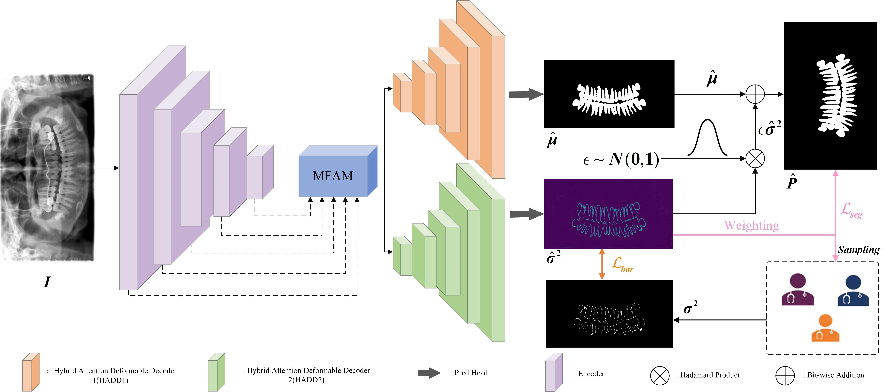
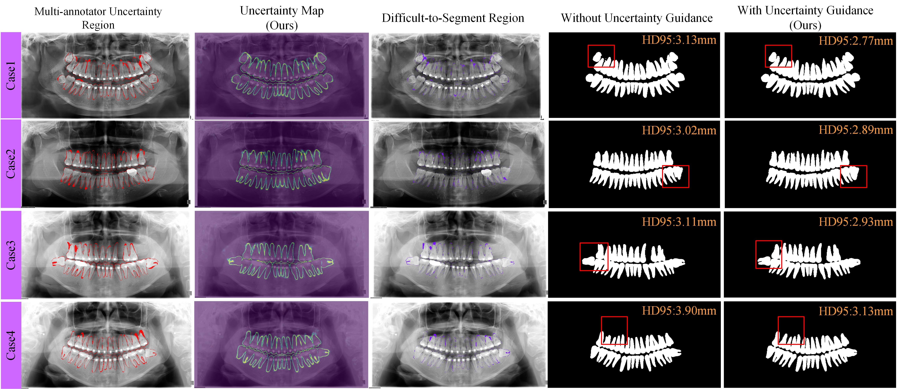

# UDS-Net: An Uncertainty-Guided Dental Segmentation Network for Panoramic Radiographs in Orthodontic Scenarios

## Overview

**UDS-Net** is an uncertainty-guided deep learning framework developed for tooth segmentation in orthodontic panoramic radiographs. It aims to address challenging segmentation scenarios involving complex root morphologies, indistinct tooth boundaries, and closely adjacent dental structures.

Unlike conventional segmentation approaches, UDS-Net explicitly leverages annotation uncertainty derived from disagreements among multiple orthodontists. By incorporating this information into model training, the proposed framework focuses on ambiguous anatomical regions and improves tooth and root boundary delineation.

## Network Architecture

UDS-Net integrates three key components:

- **Multi-scale Fusion Attention Module (MFAM):** Aggregates multi-level features to enhance global anatomical representation and tooth contour localization.
- **Hybrid Attention Deformable Decoder (HADD):** Combines attention mechanisms and deformable convolutions to improve the reconstruction of complex tooth structures and irregular boundaries.
- **Uncertainty Estimation (UE):** Employs an additional decoder to estimate pixel-wise uncertainty, supervised by variance derived from multiple expert annotations.

Furthermore, an **uncertainty-guided loss function** progressively increases the contribution of uncertain regions during training, enabling the network to learn more effectively from ambiguous tooth and root boundaries.

## Uncertainty-Guided Segmentation Refinement

The visualization illustrates the effectiveness of uncertainty-guided learning in challenging dental regions.

By analyzing multi-annotator disagreement, predicted uncertainty, and segmentation errors, UDS-Net identifies regions where anatomical boundaries are difficult to distinguish. Incorporating uncertainty guidance improves boundary localization and produces more complete tooth and root contours, particularly in regions with complex root morphologies and closely adjacent teeth.

## Experimental Results

UDS-Net was evaluated on **MAOD-Seg**, a multi-annotator orthodontic panoramic radiograph dataset containing pixel-level tooth annotations from three experienced orthodontists.

The proposed method achieved:

- **Dice:** 95.41%
- **IoU:** 91.25%
- **Precision:** 95.86%

Experimental comparisons demonstrated improved segmentation performance over representative conventional and uncertainty-aware segmentation methods, particularly in challenging tooth and root boundary regions.

## Research Significance

UDS-Net demonstrates the potential of incorporating multi-annotator uncertainty into medical image segmentation. By linking annotation disagreement with uncertainty-aware optimization, the framework provides a foundation for developing more reliable automated dental image analysis systems.

The proposed approach may support future research on orthodontic image analysis, anatomical boundary refinement, and uncertainty-aware medical image segmentation.
